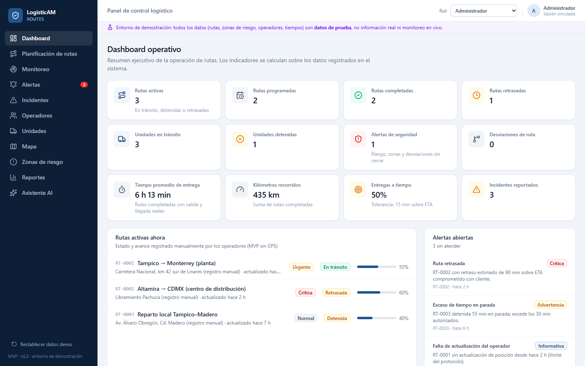
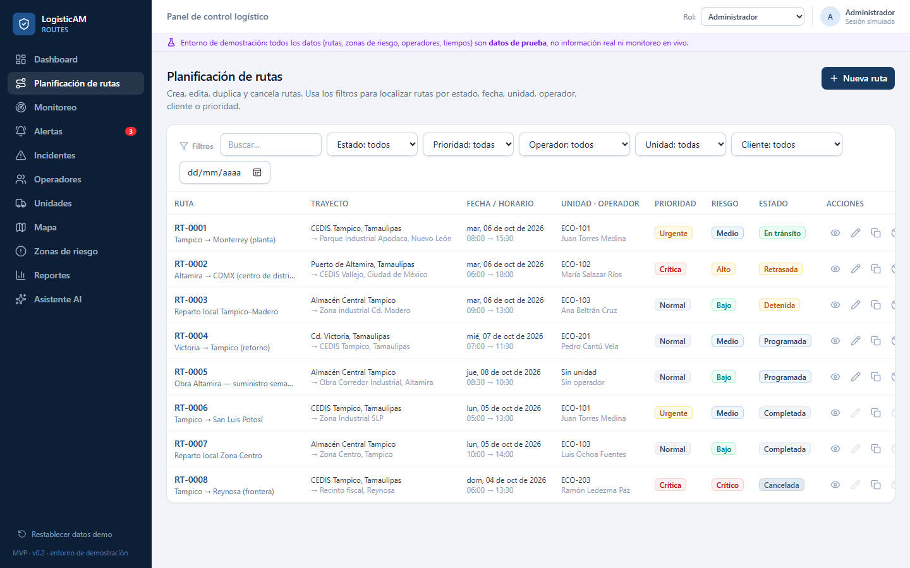
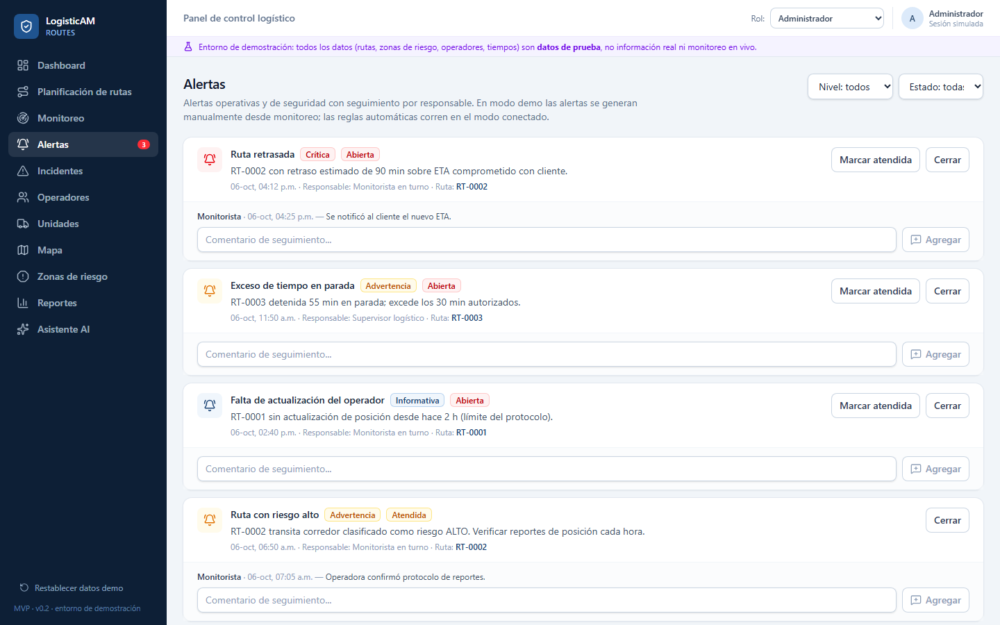

# LogisticAM Routes

Plataforma web para planear, vigilar y documentar los viajes de una flotilla de transporte de carga en México: rutas, GPS, alertas automáticas, papeles vigentes de choferes y unidades, entrega con evidencia y bitácora de horas de servicio conforme a la NOM-087-SCT-2-2017.

**Estado:** en producción para operación interna de una flotilla propia. Este repositorio es una **vitrina**: contiene la demostración compilada y la documentación. El código fuente es privado.

**Demo en vivo (datos ficticios, sin login):** https://angelmda2705.github.io/logisticam-routes-demo/

> La demo corre en el navegador con datos de prueba y no se conecta a ningún servidor; un banner permanente lo indica. Muestra el panel, la planeación de rutas, las alertas y el modo operador. El mapa real, el GPS, las alertas automáticas, los papeles, las horas de servicio y el asistente con IA solo funcionan en la versión conectada al servidor, que es la que está en producción.

## Capturas

## Qué resuelve

Un despacho de transporte maneja a la vez viajes, choferes, unidades, papeles que vencen y reglas de seguridad. LogisticAM junta eso en un solo lugar y avisa antes de que algo se salga de control, sin obligar al chofer a usar un tablero complicado.

## Qué incluye

- **Planeación de rutas** con mapa real (OpenStreetMap), orden de paradas de menor distancia, costo estimado del viaje y orden de viaje en PDF.
- **Asistente de "Nuevo viaje":** a partir de una plantilla sugiere chofer y unidad, y descarta a quien ya está ocupado, trae un papel vencido o va a manejar de más.
- **Rastreo GPS desde el teléfono del chofer**, con búfer que sobrevive a cortes de señal.
- **7 alertas automáticas** (ruta retrasada, unidad detenida, sin señal GPS, desviación de ruta y más) que se evalúan cada 5 minutos en el servidor.
- **Llegadas y salidas detectadas por GPS** (geocercas) y **entrega con evidencia**: fotos, firma con el dedo, kilometraje y PDF.
- **Papeles de choferes y unidades** con semáforo de vigencia, flujo de revisión y avisos antes de vencer.
- **Bitácora de horas de servicio (NOM-087)** calculada a partir del GPS, con avisos al chofer aun sin señal y PDF firmable.
- **Zonas de riesgo carretero** con fuente y fecha por cada dato.
- **Reporte ejecutivo diario** y asistente con IA (Llama 3.3 70B en Workers AI) con respuestas marcadas como generadas por IA.
- **Modo operador simplificado**: pantallas con texto y botones grandes, pensado para quien no se lleva con interfaces densas.
- **Operación sin señal (PWA):** la app abre y guarda cambios sin conexión y los envía sola al volver.

## Seguridad

- Contraseñas con PBKDF2 (SHA-256, 100 mil iteraciones) y sesiones con expiración.
- Bloqueo de login por IP y por cuenta, y verificación en dos pasos (TOTP).
- Permisos por rol aplicados en el servidor, no solo en la pantalla.
- Bitácora de auditoría archivada en almacenamiento aparte, y respaldos semanales con restauración probada.
- Política de seguridad de contenido estricta y CORS restringido.

## Stack

| Capa | Tecnología |
|---|---|
| Frontend | React 19, TypeScript, Vite, Tailwind CSS 4, Leaflet, Recharts, Zod |
| Backend | Cloudflare Workers, base de datos D1, almacenamiento R2, tareas programadas |
| IA | Workers AI (Llama 3.3 70B) |
| Calidad | 124 pruebas automáticas, typecheck estricto y CI en GitHub |

## Estado de cada parte

| Parte | Estado |
|---|---|
| Plataforma completa (web + API) | En producción, uso interno |
| Demo pública de este repositorio | Datos ficticios, solo navegador |
| Notificaciones por correo y WhatsApp | En desarrollo |
| Integración con telemática del vehículo (GPS dedicado) | Pendiente; hoy el GPS lo da el teléfono del chofer |

## Contacto

Ángel Mendiola, angelmendiolalux@gmail.com

El código fuente completo puede revisarse en una sesión técnica, bajo solicitud.
